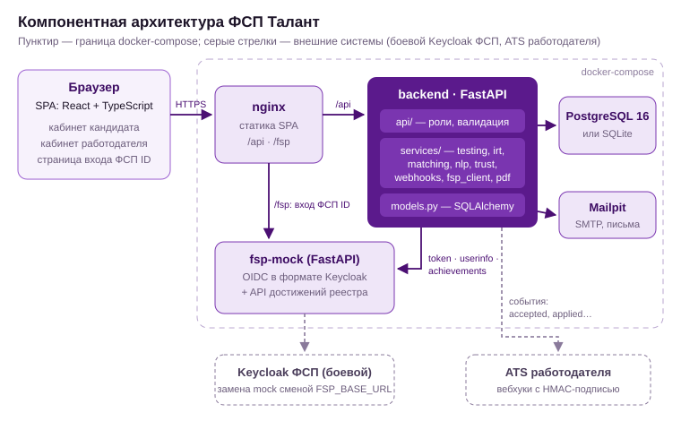
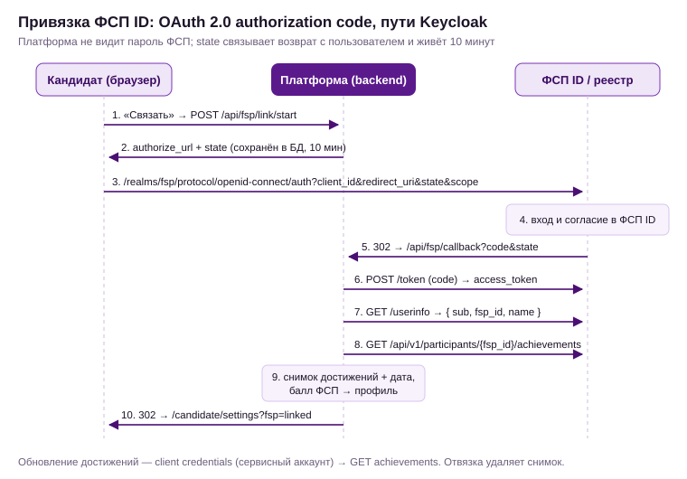

# ФСП Талант — сопроводительная документация

Цифровая платформа-агрегатор ИТ-вакансий с верифицированным профилем достижений участника ФСП.

Документ закрывает требования раздела 3.4 ТЗ:

| № | Требование ТЗ | Раздел |
|---|---|---|
| 1 | Функциональная и компонентная архитектура | 1 |
| 2 | Механика тестирования | 2 |
| 3 | Механика подбора и категоризация | 3 |
| 4 | Процедура валидации и результаты | 4 |
| 5 | Интеграция с реестром ФСП | 5 |
| 6 | Описание API | 6 |
| 7 | Библиотеки и версии | 7 |
| 8 | Сборка, развёртывание и запуск | 8 |

Защита от недобросовестных работодателей и интеграция с ATS (частично реализованы сверх MVP) — в разделе 9. Безопасность и 152-ФЗ — в разделе 10.

---

## 1. Архитектура

### 1.1. Функциональная архитектура

**Роли:**

- **Кандидат.** Регистрируется и подтверждает email. Заполняет профиль вручную или из PDF, проходит опрос, выбирает грейд и проходит адаптивный тест — так получает категорию. Затем публикует профиль, привязывает ФСП ID, получает приглашения и отвечает на них, откликается на вакансии, решает регулярные задания.
- **Работодатель.** Регистрируется и заполняет профиль компании. Описывает потребность (с NLP-разбором текста), получает подборку и сам приглашает кандидатов. Кроме того, ищет по банку кандидатов, публикует вакансии, разбирает отклики и выдаёт регулярные задания.

**Функциональные модули бэкенда:**

| Модуль | Ответственность |
|---|---|
| Авторизация | Регистрация с согласием на ПДн, подтверждение email, JWT, роли |
| Профиль кандидата | Форма, разбор PDF-резюме, опрос, приватность, согласие на публикацию, PDF-профиль |
| Тестирование | Банк параметрических шаблонов, IRT 2PL, адаптивный отбор, решение по грейду, ограничения частоты, детектор утечек, план теста под вакансию |
| Подбор | Видимость кандидатов, сила профиля, балл соответствия, причины, рекомендованные категории, подборка с шорт-листом |
| Контакт | Приглашения со статусами и квотой, раскрытие контактов, отклики на вакансии |
| Регулярные задания | Выдача по специализации и грейду, автооценка по рубрике, оценка работодателя |
| Интеграция с ФСП | OAuth 2.0 / OIDC-клиент, снимок достижений, балл ФСП |
| Доверие и интеграции | Верификация компании (ИНН + корпоративный домен), сигналы доверия в приглашении, жалобы кандидатов, вебхуки в ATS с HMAC-подписью, экспорт кандидата в JSON |

### 1.2. Компонентная архитектура




Бэкенд — монолит с явным разделением слоёв:

- `api/` — HTTP-слой: валидация, роли, сериализация;
- `services/` — бизнес-логика без зависимости от HTTP: `testing`, `matching`, `irt`, `nlp`, `pdf`, `fsp_client`, `tasks`, `trust`, `webhooks`;
- `models.py` — слой хранения: SQLAlchemy 2.0, одинаково работает с SQLite и PostgreSQL.

Модули связаны слабо: подбор читает профиль и результаты теста только через поля профиля (`grade`, `theta`, `verified_topics`). Поэтому тестирование и подбор можно выделить в отдельные сервисы без переписывания.

**Масштабирование:**

- бэкенд не хранит состояние, сессии — JWT, поэтому горизонтально масштабируется за балансировщиком;
- ранжирование выполняется в памяти по кандидатам одной специализации. Это сотни мс на тысячи профилей;
- для сотен тысяч профилей предусмотрены предварительный фильтр по категории в SQL и кэш силы профиля.

---

## 2. Механика тестирования

### 2.1. Путь кандидата

1. **Опрос:** отрасли, специализация, стек из справочника специализации, стаж, формат, ожидания, город.
2. **Самостоятельный выбор грейда:** Стажёр / Junior / Middle / Senior с описанием каждого.
3. **Адаптивный тест на заявленный грейд:** 10–20 вопросов, по 2 минуты на вопрос, без возврата к предыдущим.
4. **Результат:**
   - `confirmed` — присваивается категория;
   - `confirmed_plus` — подтверждено с запасом, можно сразу принять грейд выше;
   - `not_confirmed` — грейд **не понижается принудительно**, предлагается тест на грейд ниже.

### 2.2. Почему задания нельзя «слить»

ТЗ называет две проблемы:

- единый набор заданий быстро расходится;
- генерация нейросетью под каждого не гарантирует сопоставимой сложности.

Решение собрано из пяти механизмов.

1. **Параметрические шаблоны.** Шаблон — это генератор. Из зерна он строит уникальный экземпляр: меняются числа, имена, порядок строк кода и вариантов ответа, а проверяемое умение и его трудность остаются теми же. В банке 106 шаблонов в 6 пулах: общий `core` и 5 специализаций. Форматы — «что выведет код», вычисление, поиск ошибки, понимание концепции. У большинства шаблонов сотни и тысячи различимых экземпляров.
2. **Сложность закреплена за шаблоном (IRT 2PL).** P(верно | θ) = 1 / (1 + e^(−a(θ − b))). Параметры a (различающая способность) и b (сложность) принадлежат шаблону. Уровень кандидата θ оценивается методом EAP по всем ответам с учётом их сложности, поэтому кандидаты с разными наборами вопросов сравнимы. Грейд определяется порогами на шкале θ:

   | Грейд | Порог θ |
   |---|---|
   | Стажёр | −1,6 |
   | Junior | −0,6 |
   | Middle | 0,4 |
   | Senior | 1,4 |

3. **Адаптивность и рандомизация маршрута.** Следующий вопрос выбирается по максимуму информации Фишера в текущей θ. Учитываются:
   - приоритет тем из стека кандидата (×1,3);
   - штраф для заданий на языке, которого нет в стеке (×0,15);
   - доля общего пула — не более 35%;
   - случайный выбор из 4 лучших;
   - штраф за частый показ (×0,5 при доле показов выше 35%);
   - исключение шаблонов, которые кандидат видел за последние 180 дней.

   В результате два кандидата почти никогда не видят одинаковый набор.
4. **Правило остановки.** Тест заканчивается, когда решение уверенное (|θ − порог| ≥ 1,645·SE) относительно порога заявленного грейда и, если θ выше, — относительно следующего порога. Также тест заканчивается, если SE ≤ 0,30, и в любом случае после 20 вопросов. Параметры подобраны на валидации.
5. **Детектор утечек.** Для каждого ответа сохраняется остаток «ответ − P(θ̂)». Если по шаблону за последние 60 показов отвечают систематически лучше, чем предсказывает модель (средний остаток > 0,2 и z > 3), шаблон уходит в карантин и на ревизию. Так ловится утечка не конкретного экземпляра, а *приёма решения*.

**Ограничения частоты:**

- повтор теста на грейд, который не подтвердился, — через 30 дней;
- тест на грейд ниже доступен сразу;
- смена подтверждённого грейда — не чаще раза в 90 дней;
- принятие повышения по уверенной попытке — в течение 7 дней, и это не считается отдельной сменой.

**Роль нейросети.** LLM — инструмент *офлайн*-генерации новых шаблонов, а не заданий «на лету». Новый шаблон попадает в банк только после калибровки a и b на ответах (процедура EM в `irt.calibrate_2pl` проверена в валидации, раздел 4).

**Как из вакансии формируются задания** (требование ТЗ). Из стека и грейда вакансии система выбирает шаблоны, которые лучше всего различают кандидатов около порога нужного грейда, и показывает:

- план теста;
- покрытые и непокрытые банком темы;
- два разных экземпляра одного шаблона для двух кандидатов.

Где посмотреть: эндпоинт `GET /api/vacancies/{id}/blueprint` и интерфейс — «Вакансии → Какие задания проверяют эту вакансию» и страница «Как это работает».

**Темы, подтверждённые тестом.** Вопросы подбираются под уровень кандидата, поэтому доля верных около 50% у всех. Поэтому тема сравнивается с *ожиданием модели* при итоговой θ:

- **подтверждена** — ответы не хуже ожидаемого;
- **«слабее остальных»** — по двум и более вопросам результат заметно хуже ожидаемого.

---

## 3. Механика подбора и категоризации

### 3.1. Категоризация

- Категория = специализация (из опроса) × грейд (из теста). Всего 20 категорий: 5 × 4.
- Самоописание резюме на категорию не влияет.
- В выдачу попадают только кандидаты одновременно:
  - с подтверждённым грейдом;
  - с отдельным согласием на публикацию;
  - со статусом поиска «ищу» или «открыт к предложениям»;
  - не скрывшие профиль от этой компании.

### 3.2. Ранжирование внутри категории — сила подтверждённого профиля

**P = 0,60·T + 0,25·F + 0,15·A**

- **T** — положение θ внутри полосы грейда (от его порога до порога следующего).
- **F** — балл ФСП: F = 1 − e^(−S/1,2), где S = Σ уровень × результат × 0,5^(возраст в годах / 2).

  | Уровень | Вес | Результат | Вес |
  |---|---|---|---|
  | Международный | 1,0 | Победитель | 1,0 |
  | Всероссийский | 0,8 | Призёр | 0,75 |
  | Межрегиональный | 0,6 | Финалист | 0,5 |
  | Региональный | 0,5 | Участник | 0,25 |
  | Локальный | 0,3 | | |

- **A** — активность: оценки трёх последних регулярных заданий с затуханием 0,5^(дни / 60).

Нет истории ФСП → F = 0. Это не ошибка и не штраф: кандидат просто не получает бонуса, в интерфейсе — плашка «Нет данных ФСП». Скрытые кандидатом достижения в ранжировании не учитываются, чтобы не раскрывать их косвенно.

### 3.3. Подборка по потребности

1. Работодатель вставляет текст. NLP-разбор заполняет специализацию, грейд, обязательный и желательный стек, формат и вилку:
   - словарь около 80 навыков с русскими и английскими синонимами;
   - маркеры «будет плюсом»;
   - правила для опыта и вилки.
2. **Рекомендованные категории:** основная, соседние по грейду и смежные специализации, где кандидаты владеют ≥ 60% обязательного стека.
3. **Балл соответствия** Score = 100·(0,40·S + 0,20·P + 0,25·G + 0,15·C):
   - **S (стек):** 0,7·покрытие обязательного + 0,2·желательного + 0,1·TF-IDF-близость. Вклад навыка:

     | Статус навыка | Вклад |
     |---|---|
     | Заявлен и подтверждён тестом | 1,0 |
     | Только заявлен | 0,8 |
     | Заявлен, но тест его опроверг | 0,3 |

   - **G (категория):** совпадение грейда — 1,0; на ступень выше — 0,4; ниже — 0,35. Категория идёт первой, как требует ТЗ.
   - **C (условия):** зарплата (ожидания в вилке / превышение до 15% / больше), формат, город и переезд.

   Веса подобраны на отдельном dev-наборе валидации и проверены на отложенных данных.
4. **Объяснимость.** Каждый фактор превращается в причину со знаком «плюс» или «минус». Например: «Стек: 3 из 4 обязательных (Python, PostgreSQL, Docker); подтверждено тестом: Python», «ФСП: Призёр всероссийских соревнований…», «Ожидания выше вилки на 8%».
5. **Уточнение без потери.** Подборка хранится в БД (`selection_items`):
   - фильтры (навыки, ФСП, «уверенно в грейде», зарплата в вилке, шорт-лист, новые) применяются поверх сохранённой подборки;
   - пересчёт сохраняет шорт-лист и помечает новых кандидатов.

### 3.4. Выход на контакт — главное отличие от площадок с откликами

- **Анонимная карточка.** Работодатель видит категорию, уверенность в грейде, подтверждённые темы, достижения ФСП, результаты заданий и ожидания по зарплате. ФИО и контакты скрыты.
- **Приглашение-оффер.** Обязательные поля:
  - позиция;
  - описание;
  - вилка «от–до» в рублях (сервер отклоняет запрос без неё или с «от» > «до» — код 422);
  - компания;
  - способ связи.
- **Перед отправкой:** если вилка ниже ожиданий кандидата, работодатель видит предупреждение.
- **Статусы:** отправлено → просмотрено → принято / отклонено (с причиной, при причине «зарплата» — ожидаемая сумма) / отозвано / истекло (14 дней).
- **Раскрытие контактов:** только после принятия приглашения или собственного отклика кандидата.
- **Защита кандидата от спама и недобросовестных работодателей:**
  - недельная квота — 20 приглашений, у неподтверждённой компании — 5;
  - одно активное приглашение на кандидата от компании;
  - кандидат может скрыть профиль от конкретных компаний;
  - в каждом приглашении — блок «Надёжность работодателя»: подтверждена ли компания, доля принятых приглашений, жалобы, массовая рассылка одного текста, вилка заметно ниже рынка категории;
  - кнопка «Пожаловаться»: при 3 жалобах приглашения компании приостанавливаются.
- **Дополнительные каналы:**
  - самостоятельный отклик на опубликованную вакансию — для тех, кто ещё не получил приглашений;
  - регулярные задания от работодателей, из списка решений которых можно сразу пригласить автора.

---

## 4. Процедура валидации и результаты

Полный отчёт с таблицами, графиками и матрицей ошибок — [docs/validation/report.md](validation/report.md) (в PDF — приложение). Сырые цифры — `docs/validation/results.json`. Скрипт — `backend/validation/run_validation.py`, около 4 минут, полностью воспроизводим (фиксированные seed и PYTHONHASHSEED).

**Методика.** Эталонной разметки нет, поэтому эталон — скрытые истинные параметры генератора:

- истинный уровень θ;
- истинные навыки;
- заявленный профиль с шумом: самооценка завышена у 35%, в 35% резюме есть «приписанные» навыки.

Система видит только то, что видела бы в продуктиве. Подбор оценивается через настоящий движок и БД. Веса настраивались на отдельном dev-мире, а результаты усреднены по трём отложенным мирам.

| Что проверяем | Метрика | Наша механика | Бейзлайн |
|---|---|---|---|
| Точность грейда | доля точных / в пределах ±1 | **77% / 99,9%** | самооценка: 54% / 98,7%; единый тест той же длины: 75% |
| Согласованность при повторе | тот же грейд / каппа Коэна | 68% / 0,56 | единый тест: 66% / 0,53 |
| Точность оценки уровня | корреляция θ̂ с истинной | 0,90 | — |
| Дискриминативность | медианная точечно-бисериальная r | 0,42; у всех шаблонов r ≥ 0,2 | — |
| Устойчивость к утечке ответов | доля списывающих junior, «подтвердивших» middle | **5%** (без утечки — 8%) | единый тест: 100%; банк без параметризации: 100% |
| Детектор утечек | обнаружено / ложные срабатывания | 4 из 4 за 69–292 показа / 1 из 35 | — |
| Калибровка шаблонов | корреляция восстановленных b / a с истинными | 0,998 / 0,85 | — |
| Подбор | nDCG@10 / доля релевантных в топ-10 | **0,74 / 92%** | ключевые слова резюме: 0,59 / 76% |
| Подбор | чужая специализация в топ-10 | 0% | 10% |

**Выводы:**

- Категоризация по тесту существенно точнее самооценки.
- Параметрические шаблоны нейтрализуют утечки, к которым единый тест полностью уязвим.
- Подбор на основе категорий даёт +25% nDCG к поиску по ключевым словам.

**Честное наблюдение.** Поштучное подтверждение навыков тестом пока почти не меняет выдачу: на навык приходится 1–2 вопроса. Развитие — проверка заявленного стека регулярными заданиями.

**Ограничения:**

- синтетика проверяет корректность механики, но не реальную трудность заданий. Её покажет калибровка на ответах живых кандидатов;
- эталон релевантности задан правилами. Следующий шаг — разметка 100–200 пар рекрутерами.

---

## 5. Интеграция с реестром ФСП

### 5.1. Привязка ФСП ID (OAuth 2.0 authorization code, пути Keycloak)




- **Обновление:** client credentials (сервисный аккаунт клиента) → `GET achievements`.
- **Отвязка:** удаляет снимок.
- **Один ФСП ID** привязывается только к одному профилю.
- **Переход на боевой Keycloak ФСП** — только конфигурация: `FSP_BASE_URL`, `FSP_REALM`, `FSP_CLIENT_ID`, `FSP_CLIENT_SECRET`. Mock повторяет пути и discovery (`/.well-known/openid-configuration`).

### 5.2. Предлагаемая структура данных достижения

| Поле | Значение |
|---|---|
| `event_id`, `event_name`, `event_type` | Мероприятие: соревнование или хакатон |
| `discipline` | Алгоритмическое, продуктовое, ИБ, робототехника, БАС |
| `level` | Международный … локальный |
| `result`, `place` | Победитель / призёр / финалист / участник, место |
| `team_name`, `team_role` | Команда и роль (капитан или участник) |
| `date` | Дата проведения |

Работодателю показываем:

- бейдж лучшего достижения в выдаче;
- полный список с уровнем, дисциплиной и командой в карточке;
- балл ФСП, который влияет на ранжирование внутри категории.

**Случаи «нет истории»:**

- профиль не связан — плашка «Профиль не связан с ФСП ID»;
- связан без достижений — «Достижений в реестре ФСП пока нет».

Ни ошибок, ни штрафа в этих случаях нет.

### 5.3. Авторизация

Платформа выпускает собственные JWT (HS256, 12 часов), пароли хранятся в scrypt. Целевая схема:

- Keycloak ФСП как единый IdP: «Войти через ФСП ID» вместо пароля;
- бэкенд проверяет токены Keycloak по JWKS;
- роли — через client roles.

Модуль `security.py` изолирован, поэтому замена не затрагивает бизнес-логику.

---

## 6. Описание API

Спецификация OpenAPI 3.1:

- в рантайме — `/openapi.json`, Swagger UI `/docs`, ReDoc `/redoc`;
- выгруженная копия — [docs/openapi.json](openapi.json).

Всего 81 операция. У каждой есть описание, схема запроса и документированные коды ошибок.

| Группа | Префикс | Операций | Ключевые эндпоинты |
|---|---|---|---|
| Авторизация | `/api/auth` | 6 | `register`, `verify`, `login`, `resend`, `me` |
| Справочники и система | `/api/meta`, `/api/system` | 6 | `dictionaries`, `bank-health`, `blueprint`, `webhook-echo` (демо-приёмник ATS) |
| Кабинет кандидата | `/api/candidate` | 18 | `profile`, `resume/parse`, `survey`, `status`, `privacy`, `profile.pdf`, `invitations/*` (в т. ч. `complain`), `tasks/*` |
| Тестирование | `/api/tests` | 6 | `availability`, `start`, `{id}`, `{id}/answer`, `{id}/accept-upgrade` |
| Вакансии (кандидат) | `/api/vacancies` | 4 | список с баллом соответствия, `apply`, `blueprint` |
| Кабинет работодателя | `/api/employer` | 37 | `company`, `company/verify`, `dashboard`, `candidates`, `candidates/{id}/export.json`, `needs/*`, `needs/{id}/selection`, `invitations`, `vacancies/*`, `tasks/*`, `integrations/*` |
| Интеграция с ФСП | `/api/fsp` | 4 | `link/start`, `callback`, `refresh`, `link` (DELETE) |

**Коды ошибок:**

| Код | Когда возвращается |
|---|---|
| 401 | Нет или истёк токен |
| 403 | Не та роль; вход без подтверждённого email |
| 404 | Объект не найден или принадлежит другому пользователю |
| 409 | Ограничение частоты (с полем `available_at`), неверный статус, дубликат, не заполнен профиль компании |
| 422 | Валидация: нет вилки, «от» > «до», неизвестные коды справочников, нет согласия на ПДн |
| 429 | Исчерпана недельная квота приглашений или приглашения приостановлены из-за жалоб |

Авторизация — заголовок `Authorization: Bearer <token>`.

---

## 7. Используемые библиотеки и компоненты

**Backend** (`backend/requirements.txt`):

| Библиотека | Версия | Назначение | Лицензия |
|---|---|---|---|
| FastAPI | 0.115.5 | REST API, OpenAPI | MIT |
| Uvicorn | 0.32.1 | ASGI-сервер | BSD |
| SQLAlchemy | 2.0.36 | ORM, SQLite и PostgreSQL | MIT |
| psycopg[binary] | 3.2.3 | драйвер PostgreSQL | LGPL |
| Pydantic | 2.10.3 | схемы и валидация | MIT |
| email-validator | 2.2.0 | проверка email | Unlicense |
| PyJWT | 2.10.1 | JWT | MIT |
| python-multipart | 0.0.19 | загрузка файлов | Apache-2.0 |
| NumPy | 2.1.3 | IRT: EAP, информация Фишера, EM-калибровка | BSD |
| pypdf | 5.1.0 | извлечение текста из PDF | BSD |
| fpdf2 | 2.8.1 | генерация PDF-профиля | LGPL |
| httpx | 0.28.1 | OIDC-клиент ФСП, тесты | BSD |
| pytest | 8.3.4 | автотесты | MIT |

**Frontend** (`frontend/package.json`): React 18.3.1, React DOM 18.3.1, React Router DOM 6.28.0, TypeScript 5.6.3, Vite 5.4.11, @vitejs/plugin-react 4.3.4. Все под лицензией MIT. Шрифты Manrope и JetBrains Mono (OFL) подключаются из Google Fonts.

**Инфраструктура:** PostgreSQL 16 (PostgreSQL License), nginx 1.27 (BSD), Mailpit 1.20 (MIT), Python 3.12, Node 20.

Собственные алгоритмы без внешних ML-зависимостей: IRT 2PL, EAP, CAT, EM-калибровка, TF-IDF, NLP-правила.

---

## 8. Сборка, развёртывание и локальный запуск

### Вариант A — локально без Docker (проверен)

Требования: Python 3.12+ (проверено на 3.13), Node.js 20+ (проверено на 25).

```bash
cd backend
python3 -m venv .venv
.venv/bin/pip install -r requirements.txt
.venv/bin/python -m app.seed                 # демо-данные: 321 кандидат, 6 компаний (~20 с)
.venv/bin/uvicorn app.main:app --port 8000   # API + встроенный mock ФСП ID

cd ../frontend
npm install
npm run dev                                  # http://localhost:5173 (проксирует /api и /fsp на :8000)
```

**Production-сборка фронтенда:** `npm run build` → `frontend/dist`. Отдавать любым веб-сервером с проксированием `/api` и `/fsp` на бэкенд — см. `frontend/nginx.conf`.

### Вариант B — Docker Compose

```bash
cp .env.example .env
docker compose up --build        # http://localhost:8080, почта — http://localhost:8025
```

Сервисы: `frontend` (nginx + SPA), `backend`, `fsp-mock`, `db` (PostgreSQL 16), `mailpit`. Лимиты памяти суммарно около 1,1 ГБ.

> Compose-файл подготовлен, но не прогонялся: на машине разработки нет Docker. Отдельно проверены его составные части:
> бэкенд и все автотесты на PostgreSQL 16, схема «mock ФСП отдельным сервисом за прокси».

### Проверка

```bash
cd backend
.venv/bin/python -m pytest                            # 12 тестов правил ТЗ, доверия и вебхуков
TEST_DATABASE_URL=postgresql+psycopg://user@host/db .venv/bin/python -m pytest   # те же тесты на PostgreSQL
.venv/bin/python -m app.services.bank.selfcheck 3000  # банк заданий на 3000 зёрнах
.venv/bin/python -m validation.run_validation         # отчёт валидации с графиками (~4 мин)
python docs/build_pdf.py                              # PDF этой документации (нужны markdown и Chrome)
```

**Демо-доступ:**

| Роль | Логин | Пароль |
|---|---|---|
| Кандидат | `candidate@demo.ru` | `demo12345` |
| Работодатель | `employer@demo.ru` | `demo12345` |
| ФСП ID | `FSP-100001` / `FSP-100002` / `FSP-100003` (без истории) | `demo` |

---

## 9. Сверх MVP: защита от недобросовестных работодателей, интеграция с ATS, развитие

### 9.1. Защита от фиктивных вакансий и недобросовестных работодателей

**Реализовано в MVP** (`services/trust.py`, страница «Компания», карточка приглашения у кандидата):

| Механизм | Как работает |
|---|---|
| Верификация компании | ИНН с проверкой контрольной суммы по алгоритму ФНС (10 и 12 цифр) + контактный email на домене сайта компании; бесплатные почтовые домены не принимаются. Изменение ИНН, сайта или email снимает подтверждение |
| Сниженная квота | Неподтверждённой компании — 5 приглашений в неделю вместо 20 |
| Сигналы доверия кандидату | В каждом приглашении: бейдж «ИНН и домен подтверждены», доля принятых приглашений компании за 90 дней, число жалоб, предупреждение о массовой рассылке (один текст 10+ кандидатам за неделю), предупреждение о вилке ниже 70% медианы ожиданий категории |
| Жалобы | Кандидат жалуется с причиной (фиктивная вакансия, спам, условия не соответствуют, некорректное общение). Открытое приглашение закрывается без раскрытия контактов. При 3 жалобах приглашения компании приостанавливаются до проверки модератором |
| Приватность сигналов | Пометку «вилка ниже ожиданий» работодатель видит, только если кандидат не скрыл ожидания |

**Развитие:**
- сверка ИНН с ЕГРЮЛ ФНС (статус «действующая», возраст компании) и код подтверждения на корпоративный email;
- рейтинг работодателя по событиям после принятия приглашения: «пропал после принятия» больше 30% — снижение квоты;
- детектор шаблонных текстов по шинглам и MinHash (сейчас — точное совпадение);
- автозакрытие вакансий без ответов работодателя дольше 30 дней, модерация жалоб в админке;
- лимиты просмотров карточек в сутки против скрейпинга (контакты уже раскрываются только с согласия кандидата).

### 9.2. Интеграция с ATS работодателей

**Реализовано в MVP** (`services/webhooks.py`, страница «Компания» → «Интеграция с ATS»):

| Механизм | Как работает |
|---|---|
| Исходящие вебхуки | События `invitation.accepted` (с контактами), `invitation.declined` (причина, ожидания), `application.created` (с контактами), `task.submitted`, а также тестовый `ping` |
| Подпись и идемпотентность | Заголовки `X-FSP-Signature: sha256=HMAC_SHA256(секрет, тело)`, `X-FSP-Event`, `X-FSP-Delivery` (ключ идемпотентности). Секрет выпускается и перевыпускается в интерфейсе |
| Надёжность доставки | Фоновая отправка, до 3 попыток с паузами 1 и 3 с, журнал доставок со статусом, кодом ответа и ошибкой |
| Экспорт кандидата | `GET /api/employer/candidates/{id}/export.json` — после раскрытия контактов; структура близка к HR-Open Standards: person, position, skills (с пометкой «подтверждено тестом»), credentials (достижения ФСП) |
| Демо-приёмник | `POST /api/system/webhook-echo` проверяет подпись и запоминает события — демо-работодатель подключён к нему, жюри видит успешные доставки |

**Развитие:**
- входящий REST для синхронизации стадий из ATS (`interview`, `offer`, `hired`, `rejected`) — обратная связь для качества подбора и калибровки весов;
- готовые коннекторы к распространённым ATS через адаптерный слой;
- OAuth 2.0 client credentials для серверных интеграций через тот же Keycloak.

### 9.3. Развитие механик

- **Калибровка a и b** по реальным ответам (EM уже реализован) и пересчёт порогов грейдов экспертной процедурой (метод Ангоффа).
- **LLM как офлайн-генератор новых шаблонов** с обязательной калибровкой. LLM-оценщик открытых ответов в регулярных заданиях по той же рубрике.
- **Проверка заявленного стека** регулярными заданиями: каждое задание закрывает навык из стека.
- **Песочница для задач с кодом** (изолированный раннер с лимитами) — формат «напишите функцию».

---

## 10. Безопасность и 152-ФЗ

- **Согласие на обработку ПДн** обязательно при регистрации, время согласия сохраняется. Согласие на публикацию профиля даётся отдельно и отзывается в один клик: профиль сразу пропадает из выдачи.
- **Минимизация.** Работодатель до раскрытия видит только обезличенный профиль (псевдоним `К-1042`). Контакты отдаются API только при принятом приглашении или собственном отклике — это покрыто автотестом.
- **Роли** проверяются на каждом эндпоинте. Эндпоинты кандидата не принимают `candidate_id` извне. Объекты другой компании отдаются как 404.
- **Пароли** — scrypt с солью. Токены подтверждения email хранятся только в виде хэша. JWT подписан секретом из окружения.
- **Верный ответ теста** (`correct_index`) никогда не покидает сервер.
- **Данные ФСП** хранятся снимком с датой получения и удаляются при отвязке.
- **Жалобы** анонимны для работодателя; пометка «вилка ниже ожиданий» не раскрывает скрытые кандидатом ожидания.
- **Вебхуки** подписываются HMAC-SHA256, секрет хранится у компании и перевыпускается в один клик.
- **Для продуктива:** HTTPS, ротация `SECRET_KEY`, хранение ПДн на серверах в РФ, журнал доступа к контактам, срок хранения неактивных профилей.
