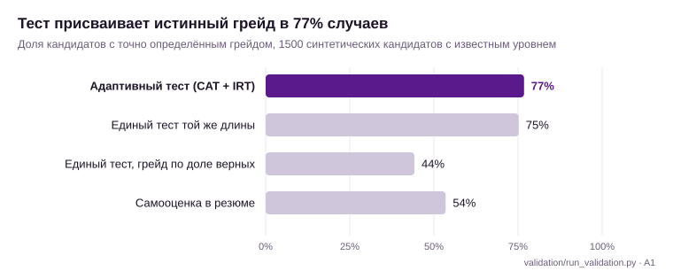
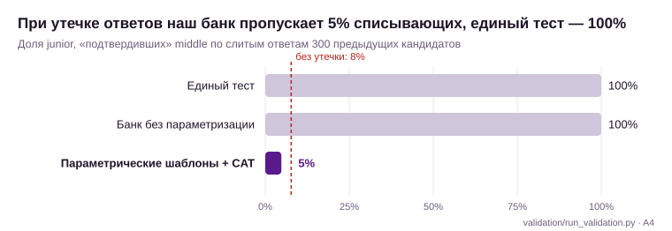
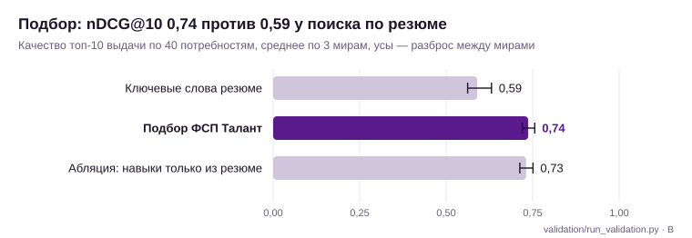

# Валидация решения «ФСП Талант»

Сгенерировано скриптом `backend/validation/run_validation.py` (2026-10-11 19:07). Банк: 106 шаблонов.

## Методика

Эталонной разметки нет, поэтому эталон — **скрытые истинные параметры генератора**. У каждого синтетического кандидата есть истинный уровень θ (по нему определяется истинный грейд), истинные навыки и заявленный профиль с шумом: самооценка грейда завышена у 35%, в 35% резюме есть «приписанные» навыки. Система видит только то, что увидела бы в продуктиве: ответы на тест и заявленный профиль. Ответы моделируются по IRT 2PL. Все прогоны детерминированы (фиксированные seed).

## Итоги

- **Категоризация.** Адаптивный тест присваивает истинный грейд в 77% случаев и ошибается не больше чем на ступень в 99.9%. Самооценка в резюме даёт 54% и завышает грейд у 34% кандидатов. По точности CAT сопоставим с единым тестом той же длины (75%), но единый тест полностью уязвим к утечкам (см. ниже).
- **Устойчивость к распространению заданий.** При утечке ответов единый тест «подтверждает» middle у 100% списывающих junior. Банк без параметризации — тоже у 100%. Наш банк — у 5%, на уровне честного прохождения (8%).
- **Утечка приёма решения** обнаруживается детектором: 4 из 4 шаблонов уходят в карантин за 70–300 показов.
- **Подбор.** nDCG@10 0.74 против 0.59 у поиска по ключевым словам резюме (+25%). Доля релевантных в топ-10 — 92% против 76%. Кандидатов чужой специализации в топе — 0% против 10%.
- **Честное наблюдение.** Поштучное подтверждение навыков тестом почти не меняет выдачу (абляция: nDCG 0.73). При ~18 вопросах на ~40 тем на навык приходится 1–2 вопроса, и сигнал слабый. Выигрыш даёт категоризация по тесту. Точечную проверку навыков развиваем через регулярные задания по заявленному стеку.

## A1. Точность присвоения грейда

1500 кандидатов проходят полный путь платформы: тест на заявленный грейд; при неудаче — тест на предложенный грейд ниже; при уверенном результате — принятие грейда выше.

| Механика | Точно | ±1 грейд | Завышено |
|---|---|---|---|
| **Наш адаптивный тест (CAT + IRT)** | 76.8% | 99.9% | 10.6% |
| Единый тест той же длины (18 заданий), оценка по IRT | 75.2% | 99.9% | 11.9% |
| Единый тест, грейд по доле верных | 44.2% | 96.0% | 4.3% |
| Самооценка кандидата (резюме) | 53.5% | 98.7% | 34.3% |

Матрица ошибок нашего теста (строки — истинный грейд, столбцы — присвоенный):

| истина \ итог | none | intern | junior | middle | senior |
|---|---|---|---|---|---|
| none | 47 | 12 | 0 | 0 | 0 |
| intern | 28 | 182 | 56 | 0 | 0 |
| junior | 0 | 54 | 465 | 53 | 0 |
| middle | 0 | 0 | 83 | 339 | 38 |
| senior | 0 | 0 | 1 | 23 | 119 |

## A2. Согласованность (повторное прохождение)

Тот же кандидат проходит путь второй раз и получает новые экземпляры заданий и другой маршрут CAT.

| Механика | Тот же грейд | Каппа Коэна |
|---|---|---|
| Наш тест | 68.3% | 0.56 |
| Единый тест | 66.0% | 0.533 |

Корреляция θ̂ между первой и повторной попыткой: **0.826**.

## A3. Дискриминативность и точность оценки уровня

| Показатель | Наш тест | Единый тест |
|---|---|---|
| Корреляция θ̂ с истинным θ | 0.903 | 0.904 |
| RMSE θ̂ | 0.455 | 0.446 |
| Вопросов в тесте | 18.18 (в среднем) | 18 |

- Средняя стандартная ошибка θ̂ на выходе: 0.431.
- Разрыв θ̂ между сильным и слабым квартилями: 2.396.
- Шаблонов с достаточной статистикой: 106; медианная точечно-бисериальная корреляция ответа с уровнем: **0.418**; доля шаблонов с r ≥ 0,2: 100%.
- Медиана r по пулам: backend: 0.423, core: 0.376, data: 0.415, devops: 0.427, frontend: 0.444, qa: 0.431.

В адаптивном тесте вопросы подбираются близко к уровню кандидата, поэтому r здесь ниже, чем в неадаптивной выборке. Это ожидаемо и не означает слабых заданий.

## A4. Устойчивость к распространению заданий

Сценарий: задания и ответы 300 первых кандидатов выложены в сеть. Затем 400 «списывающих» с истинным уровнем junior заявляют middle и отвечают верно на любое задание из слитой базы.

| Механика | Доля выданных заданий, найденных в слитой базе | Подтвердили middle | Завышение θ̂ |
|---|---|---|---|
| Единый тест | 100% | 100% | +3.23 |
| Банк без параметризации (CAT, одинаковые экземпляры) | 100% | 100% | +3.30 |
| **Наш банк: параметрические шаблоны + CAT** | 0% | 5% | -0.11 |
| Справочно: те же кандидаты без утечки | — | 8% | — |

## A5. Детектор утечек

Утекает не конкретный экземпляр, а приём решения 4 шаблонов среднего уровня. После утечки 30% кандидатов отвечают на них верно с вероятностью 0,95. Детектор считает остатки «ответ − P(θ̂)» по окну из 60 показов и отправляет шаблон в карантин при среднем остатке > 0,2 и z > 3.

- Обнаружено утёкших шаблонов: **4 из 4**.
- Показов после утечки до карантина: `backend.async_gather_time` — 93, `backend.py_exceptions` — 292, `backend.retry_idempotency` — 131, `core.git_commands` — 69.
- Ложные срабатывания при утечке: 1 из 35; в контроле без утечки: 1. Карантин не удаляет шаблон, а отправляет его на ревизию: после проверки методистом шаблон возвращается или заменяется новым.

## A6. Калибровка параметров шаблонов

Проверяем процедуру калибровки для реальных данных. 3000 человек отвечают на 20 случайных шаблонов из 35. По ответам EM-алгоритм (MML, Бок–Эйткин) восстанавливает a и b.

| Параметр | Корреляция с истинным | RMSE |
|---|---|---|
| a (различающая способность) | 0.85 | 0.081 |
| b (сложность) | 0.998 | 0.071 |

Время калибровки: 1.3 с. В продуктиве экспертные a и b заменяются откалиброванными по мере накопления ответов.

## B. Качество подбора

В каждом из 3 независимых миров (seed 5, 6, 7) 500 синтетических кандидатов прошли тест через настоящий движок и БД. Веса подбора настраивались на отдельном мире (seed 105), который в отчёт не входит. Ниже — среднее по мирам, в скобках — разброс. По 40 случайным потребностям сравниваем топ-10 выдачи с эталонной релевантностью, посчитанной по скрытой истине:

- **2** — истинная специализация совпадает, истинный грейд совпадает, кандидат реально владеет ≥ 75% обязательного стека, ожидания в пределах вилки +10%;
- **1** — грейд в пределах ±1 и владеет ≥ 50% стека;
- **0** — остальные.

Доля кандидатов, чья категория совпала с истинным грейдом: **58.9%**. Это ниже, чем в A1, потому что здесь моделируется незнание конкретных технологий: такие задания кандидат решает хуже, и тест честно снижает оценку прикладного уровня, а «истинный» грейд задан только общим уровнем θ.

| Система | P@10 (rel ≥ 1) | P@10 (rel = 2) | nDCG@10 | MRR | Чужая специализация в топ-10 |
|---|---|---|---|---|---|
| Бейзлайн: ключевые слова резюме + самозаявленный грейд | 75.6% (72%–79%) | 27.6% | 0.590 (0.56–0.63) | 0.595 | 9.7% |
| **Наш подбор** | 91.9% (90%–93%) | 34.9% | 0.737 (0.72–0.76) | 0.674 | 0.0% |
| Абляция: наш подбор, но навыки только по резюме (без подтверждения и опровержения тестом) | 91.4% (90%–92%) | 34.2% | 0.731 (0.71–0.75) | 0.684 | 0.0% |

## Ограничения

- Данные синтетические, ответы моделируются той же моделью IRT, что лежит в основе оценки. Это проверяет корректность механики, но не реальную трудность заданий. Её покажет калибровка (A6) на ответах живых кандидатов.
- Эталон релевантности (B) задан правилами команды. Следующий шаг — экспертная разметка 100–200 пар «вакансия — кандидат» рекрутерами ФСП и партнёров.
